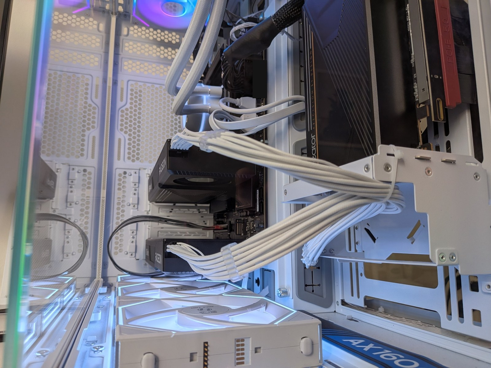

# RDNA4 Local AI Lab

**Measured, reproducible local AI on 3× AMD Radeon AI PRO R9700 — from a data centre operations point of view.**

I'm Sam Sultan, an infrastructure and operations analyst in Sydney. I built a three-GPU AMD workstation to find out what it actually takes to run large language models on your own hardware: what it costs, where it breaks, and what a business is really buying when it keeps AI in-house. This repo is my lab notebook — every number here was measured on my rig, and every test can be rerun.



---

## Headline findings

| | Finding | Detail |
|---|---|---|
| 🧠 | **Blind eval: the 177B beats the 80B by 5–9 points out of 30, at a quarter of the speed** | 15 prompts from my own work, two AI judges (69% agreement), code actually run. Qwen3.8 27–28/30 vs the 80B 18–23/30; the 80B answers ~3.7× faster. → [Finding 04](findings/04-qwen38-vs-80b-blind-eval.md) |
| 🔧 | **One config line was costing 61% of generation speed** | `HSA_ENABLE_SDMA=0`, a Strix Halo (APU) setting, cut an 80B model from 54.3 to 21.0 tokens/s on discrete RDNA4 cards. Found by bisection and fixed. The setting turned out to be a local addition in my own config, not the project's (see the correction in the finding). → [Finding 02](findings/02-hsa-enable-sdma.md) |
| ⚡ | **Electricity: ~A$0.71 (US$0.49) per million tokens generated, ~A$0.03 (US$0.02) per million read** | Measured at the wall: 80 W idle, 425–440 W generating, up to 886 W reading long prompts. → [Finding 03](findings/03-power-and-cost.md) |
| ☁️ | **On total cost, the cloud wins** | Against renting the same model, ~A$13k of hardware takes ~17 years of nonstop generation to pay back. Against a frontier-lab small model, ~1.2 years. Local AI is a control decision, not a cheap-tokens decision. → [Finding 03](findings/03-power-and-cost.md) |
| 🧩 | **Splitting a model across cards: −7% writing, +50% reading** | Pipeline (layer) split costs ~1 ms per hand-off whether the link is PCIe 5.0 x8 or 4.0 x4. → [Finding 01](findings/01-pcie-topology-and-layer-split.md) |
| 🧮 | **Two cards are 5% faster for the 80B, but can't hold 128K context** | Dropping the chipset card: 57.3 vs 54.6 t/s (A–B–A tested). But two cards are ~1 GB short of a 128K context even with an 8-bit cache, so long-context work stays on three. → [Finding 01](findings/01-pcie-topology-and-layer-split.md#follow-up-2026-10-20-the-80b-on-two-cards-vs-three) |
| 🚀 | **Updating llama.cpp alone: +19%** | Same 80B, same three cards, same flags: 51.8 → 61.8 t/s (b8763 → b11804), A–B–A with the old engine repeated at the end. → [data](data/2026-10-25-engine-upgrade-aba.md) |
| 🔌 | **The chipset slot costs ~12% on its own** | The card on the chipset-attached PCIe 4.0 x4 slot decodes 12% slower alone, with clocks and temperatures matched. Slot swap pending to confirm. → [Finding 01](findings/01-pcie-topology-and-layer-split.md) |

## Numbers at a glance

llama.cpp b8763 (HIP, rocWMMA flash attention), ROCm 7.2, `-ngl 99 -sm layer -fa 1`, mean of 5 runs. Wall power is for the whole rig.

| Model | Quant | Cards (PCIe) | Generation t/s | Prompt t/s | Wall W |
|---|---|---|---|---|---|
| Qwen3.6-35B-A3B | UD-Q4_K_M | 1 (5.0 x8) | 75.4 (tg128) | 2,292 (pp512) | |
| Qwen3.6-35B-A3B | UD-Q4_K_M | 1 (chipset 4.0 x4) | 66.2 (tg128) | 2,271 (pp512) | |
| Qwen3.6-35B-A3B | UD-Q4_K_M | 2 (x8 + x8) | 70.3 (tg128) | 3,375 (pp2048) | |
| Qwen3-Coder-Next 80B-A3B | UD-Q6_K | 3 (x8 + x8 + x4) | 54.6 (tg2048) | 2,373 (pp4096) | 425–440 gen · ≤886 prompt |
| Qwen3-Coder-Next 80B-A3B | UD-Q6_K | 2 (x8 + x8), `-ub 256` | 57.3 (tg2048) | | |
| Qwen3-Coder-Next 80B-A3B ¹ | UD-Q6_K | 3 (x8 + x8 + x4), `-ub 256` | **61.8** (tg2048), vs 51.8 on b8763 same session | | |
| Qwen3.8-Flash-Next 177B-A3B ¹ | UD-Q3_K_XL | 3 (x8 + x8 + x4), `-ub 256` | 36.2 (tg2048) | 1,251 (pp512) | |
| Qwen3.8-Flash-Next 177B-A3B ¹ | UD-Q3_K_XL | 2 (x8 + x8), `-ub 256` | 37.5 (tg2048) | | |

¹ llama.cpp build 11804 (`ghcr.io/ggml-org/llama.cpp:full-rocm`), +19% over b8763 on the same 80B ([A–B–A](data/2026-10-25-engine-upgrade-aba.md)). Qwen3.8: 51 B of its parameters are an n-gram lookup table kept in system RAM.

Model hashes, exact commands and every run are in [`data/`](data/).

## Run it on your rig

```bash
# generation speed, same flags as the table above
llama-bench -m <model>.gguf -ngl 99 -sm layer -fa 1 -p 0 -n 2048 -r 5 -o md
```

The full method (provenance capture, GPU logger, service stop/restore) is in [`bench-kit/`](bench-kit/). Finding 02 has a one-command reproduction in [`repro/`](repro/).

**Got different hardware?** [Submit your numbers](https://github.com/getsamsultan/rdna4-local-ai-lab/issues/new?template=rig-results.yml): same model file and flags, and we can compare rigs like-for-like.

## Upstream

- [Osmantic/ODS #7786](https://github.com/Osmantic/ODS/issues/7786) — the SDMA slowdown. The maintainer confirmed the setting was never in upstream; it came from my local config.
- [Osmantic/ODS #7787](https://github.com/Osmantic/ODS/issues/7787) — discrete RDNA4 setup notes: installer picked the iGPU target (gfx1036), empty `HSA_OVERRIDE_GFX_VERSION` broke detection, configured llama.cpp args not reaching the server

## The rig

| Component | Detail |
|---|---|
| GPUs | 3× ASRock Radeon AI PRO R9700 Creator, 32 GB GDDR6 each (gfx1201, RDNA4) — 96 GB total |
| CPU | AMD Ryzen 9 9950X (16C/32T) |
| Memory | 2× 48 GB DDR5-5600 |
| Board | ASUS ProArt B850 |
| PCIe | GPU0 & GPU1: PCIe 5.0 x8 (CPU lanes) · GPU2: PCIe 4.0 x4 (chipset, via riser) |
| PSU / case / cooling | Corsair AX1600i · Lian Li O11 Dynamic EVO XL · Lian Li Galahad II 360 AIO |
| Software | Ubuntu 24.04.5, kernel 7.0 · ROCm 7.2 (containers) · llama.cpp b8763 (HIP, rocWMMA flash attention) · ODS stack with Lemonade |
| Power metering | Plug-in wall meter (±1.5%), rig only |

## How I test

1. **Provenance before numbers.** OS, kernel, CPU governor, PCIe links, ROCm, llama.cpp commit and the model's sha256 are recorded with every run.
2. **One variable at a time.** Every comparison changes exactly one thing.
3. **Repeat and check: A–B–A, the omega-3 of benchmarking.** 3–5 runs per test, run in A–B–A order: the baseline, the change, then the baseline again. If the two A runs agree, any difference in B is the change, not heat, warm-up or drift. Plus a sanity check that results are physically possible.
4. **Benchmark *and* real use.** `llama-bench` numbers are checked against real requests through the serving stack — Finding 02 only showed up in real serving.
5. **Wording follows evidence.** "Points to" until it's proven.

## Repo layout

```
findings/     One write-up per finding: question, method, data, conclusion
data/         Raw results and the power/cost workbook (edit the yellow cells to use your own prices)
docs/         Command reference: the less obvious commands, when I used them, and where they fit in the ROCm certification
bench-kit/    Runbook, power-monitoring guide and scripts (provenance, GPU logger, benchmark matrix)
repro/        One-command reproduction of Finding 02
images/       Diagrams and photos
ROADMAP.md    What's been done, and what's next
```

## Sister repo

[model-editing-lab](https://github.com/getsamsultan/model-editing-lab): what it costs to change an open model's weights (directional ablation, LoRA), measured on the same rig.

## What's next

ROCm 10 side-by-side · physical slot swap · multi-user (batched) serving cost · auditing what a "local" stack sends out · whole-apartment energy monitoring with an ESP32 and a mini EPMS · Modbus security lab. Details in [ROADMAP.md](ROADMAP.md).

---

<sub>Measurements, hardware and decisions are mine. Write-ups were drafted with an AI assistant and checked against the raw data. Scripts are provided as-is under the MIT licence. Not affiliated with AMD, ASRock or the ODS project.</sub>
