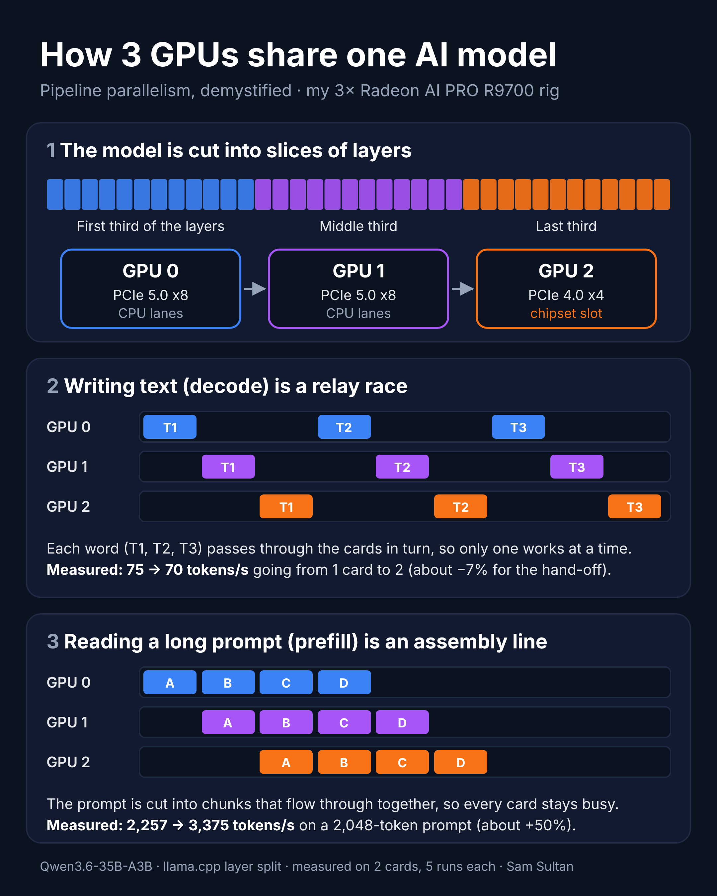

# Finding 01 — PCIe topology and the cost of splitting a model

**Date:** 2026-10-07 · **Model:** Qwen3.6-35B-A3B-UD-Q4_K_M (20.6 GiB, fits on one card) · **Engine:** llama-bench, llama.cpp b8763, ROCm 7.2

## Questions

1. Does the card on the chipset slot perform worse than the cards on CPU lanes?
2. What does splitting a model across two cards cost, and does link bandwidth matter?

## Topology (measured at the upstream switch ports)

| GPU | Path | Negotiated link |
|---|---|---|
| 0 | CPU root port | PCIe 5.0 x8 |
| 1 | CPU root port | PCIe 5.0 x8 |
| 2 | Chipset — shared with 2× 5GbE, Wi-Fi, USB, SATA | PCIe 4.0 x4 |

> The cards report 32 GT/s x16 on their own side — that's the card's internal switch, not the slot. The real slot link is on the upstream port.

## Method

`-ngl 99 -sm layer -fa 1 -p 512,2048 -n 128 -r 5`, all other services stopped, VRAM at 0% before each run. The first two-card configuration was repeated at the end as a heat-soak check.

## Results (tokens/s, mean ± sd, n = 5)

| GPUs | pp512 | pp2048 | tg128 |
|---|---|---|---|
| 0 | 2291.79 ± 10.97 | 2256.65 ± 8.45 | 75.39 ± 0.13 |
| 1 | 2300.17 ± 12.35 | 2267.50 ± 7.97 | 75.26 ± 0.20 |
| 2 (chipset) | 2270.74 ± 12.72 | 2216.70 ± 6.50 | 66.18 ± 0.10 |
| 0,1 | 2196.86 ± 10.40 | 3375.46 ± 5.66 | 70.27 ± 0.31 |
| 0,2 | 2159.88 ± 12.36 | 3309.45 ± 7.08 | 66.17 ± 0.23 |
| 1,2 | 2152.55 ± 13.49 | 3302.71 ± 6.06 | 65.78 ± 0.19 |
| 0,1 (repeat) | 2182.14 ± 10.55 | 3366.49 ± 6.04 | 70.26 ± 0.32 |

## What it shows

- **Chipset card alone: −12% generation** (66.2 vs 75.3 t/s), prompt processing within 2%. Clocks (~3.35 GHz), memory clock and junction temperature (53–55 °C) matched the CPU-lane cards under load, which **points to** the chipset path rather than the card. A physical slot swap is pending to confirm.
- **The hand-off costs ~1 ms per token, regardless of link.** Modelling a pair as the average of the two cards' single-card times plus a hop gives 0.96 ms (x8↔x8), 0.93 ms and 1.00 ms (x8↔x4). Doubling the link bandwidth didn't shrink it.
- **Splitting a model that fits on one card: −7% writing, +50% reading.** Generation is a relay race — each token passes through the cards in turn. Long prompts are an assembly line: pp2048 is four 512-token chunks that flow through both cards at once. pp512 is a single chunk, so it gains nothing.
- **Generation isn't bandwidth-bound here:** ~75 t/s × ~1.8 GB of active weights ≈ 137 GB/s, against 640 GB/s available per card.

> Splitting a model that fits on one card was deliberate — it isolates the cost of splitting. Models too big for one card are where multiple GPUs pay off (see Finding 03, 80B on three cards).

Raw data: [`data/2026-10-07-rocm72-baseline.md`](../data/2026-10-07-rocm72-baseline.md)
